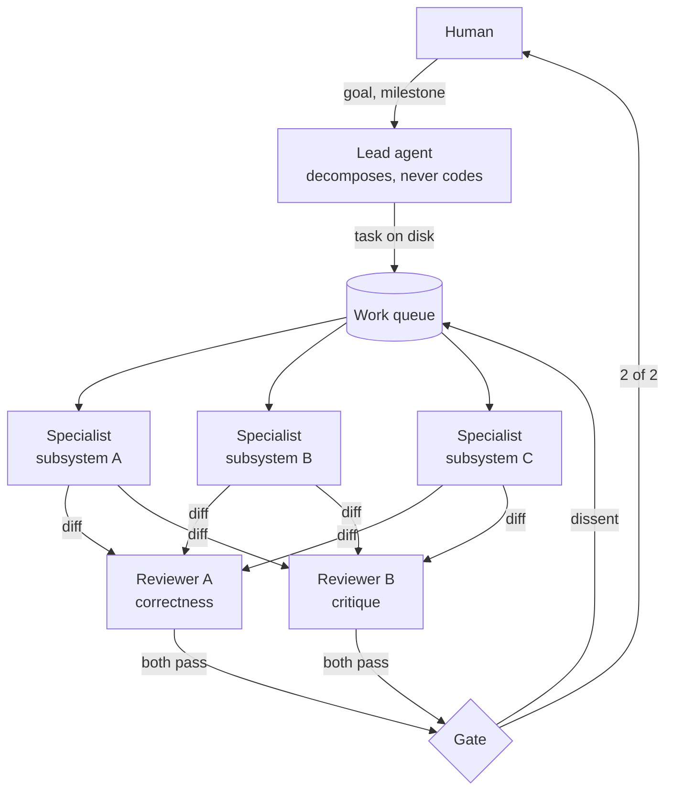

# Running a Team of Coding Agents

*Notes on a lead-and-specialists agent architecture: what it looked like, which decisions held up, and where it broke.*

## One agent doesn't scale past one workstream

The work that started this was a long migration: moving a large system onto different foundations, across several repositories, over months. Very little of it was individually hard. There were simply a great many pieces, each with its own configuration to get right and its own way of being subtly wrong, and the tail is the whole job.

A single coding agent handles that badly, and it fails quietly rather than dramatically.

It doesn't lose competence. It loses **place**. Context fills with the last thing it touched, so the twentieth change gets less care than the second, not because the model got worse, but because the earlier reasoning is no longer in front of it. Decisions get silently re-litigated: something settled on Tuesday is solved differently on Thursday, both ways defensible, neither reconciled.

The failure is invisible from inside the session. The agent reports progress accurately at every step, because every step genuinely did succeed. Only the shape of the whole is wrong.

The naive fix is a bigger context window. It helps at the margin, but it treats a coordination problem as a memory problem. What's missing is what a tech lead provides on a human team: someone holding the shape of the work who is *not* doing the work, and a record of decisions that outlives whoever is currently at the keyboard.

So the question was narrower than "can agents write code":

> What is the least structure that lets several agents work one codebase for months without the result going incoherent?

## The shape: a lead, specialists, and two gates

What settled out was four roles, and the important part is that they are separated by **what they're allowed to do**, not just by what they're told they are.



**The lead decomposes and does not implement.** This is the load-bearing rule. The moment the lead edits code it acquires the same context-crowding problem as the single agent, and the decomposition degrades first because it's the least urgent thing in the window. Keeping it out of the diff is what keeps it able to hold the shape.

**Specialists are scoped by domain and by filesystem.** Each owns a set of paths. A specialist that wanders into another specialist's area is not producing bad work exactly, it's producing work nobody asked for and nobody is reviewing against a spec, and it's the main way two agents silently undo each other.

**Two reviewers gate every diff before a human sees it.** They have different briefs: one checks the change does what the task said and doesn't break what's around it; the other argues against the approach. Both must pass. Either can send it back.

**The human reviews last, and reviews less.** The point of the gates isn't to replace human review. It's to make sure that what arrives has already survived an argument, so human attention goes to judgement calls rather than to things a careful reader would have caught.

## Decision: work lives on disk, not in a session

The first real decision was to stop treating the conversation as the system of record.

Every work item became a file, a markdown task with frontmatter for status, owner, and any PRs attached to it, in a flat store, with a queue laid over it as directories per role and per state:

```
queue/<role>/pending/     → symlink into tasks/
queue/<role>/in-progress/
queue/<role>/done/
```

Moving a task between states is moving a symlink. That sounds primitive, and it is, which is the point.

**What it bought:**

- **Agents became restartable.** A session dying mid-task stopped being data loss. The task is still sitting in `in-progress/` with its spec intact, and whoever picks it up next reads the same file.
- **State became inspectable without an agent.** `ls` answers "what is everyone doing". I could see the system's state without asking it to describe itself, which matters, because an agent describing its own state is exactly the thing you can't trust when something has gone wrong.
- **Handoffs stopped needing a conversation.** The task file *is* the handoff. No summarising context from one agent into a prompt for another, which is where detail was being lost.
- **The decision record survived.** Tasks accumulate the reasoning that produced them. Six weeks later, "why is it done this way" has a file with an answer, not a search through transcripts.

**What it cost:** a real vocabulary problem. Status values drift the moment more than one writer exists: `done` vs `completed`, `awaiting_review` vs `in_review`. I ended up needing a declared canonical set plus an explicit alias map, and tooling that flags anything outside it instead of guessing. Guessing at a status is how you get a task that's silently finished twice.

The general lesson: **if the coordination state only exists in a context window, you don't have coordination, you have a conversation that is going well so far.**

## Decision: two reviewers, with different jobs

One reviewer doesn't work, and the reason isn't capability.

A single reviewer agent reading a diff alongside the task that produced it agrees with it. Not because it's careless, but because the diff is a coherent answer to the question it was handed, and "is this a coherent answer to this question" is the easy check. The hard check is "is this the right question", and a reviewer holding the same task description has already accepted the premise.

So the two reviewers were given deliberately different briefs:

|  | Reviewer A | Reviewer B |
| --- | --- | --- |
| Question | Does this do what the task said, correctly? | Should this have been done this way at all? |
| Reads | The diff, the task, surrounding code | The diff, the task, and the *alternatives* |
| Typical catch | Broken edge case, missed call site, untested path | Wrong abstraction, scope creep, a simpler option ignored |
| Failure if alone | Passes well-built wrong things | Bikesheds well-built right things |

Both must pass for the change to reach a human. Either can bounce it back to the queue with a reason, and the reason becomes part of the task file.

Two further rules turned out to matter more than the split itself:

1. **The gate is recorded against the commit, not the conversation.** A pass is a record keyed to a specific SHA. Push a new commit and the previous approval doesn't travel with it. Without this, "it was reviewed" degrades into "an earlier version of it was reviewed", which is worse than no gate because it reads like one.
2. **Dissent supersedes.** If one reviewer passes and the other objects, the objection wins by default, with no tiebreak. Tiebreaks between agents are cheap to generate and mean very little; making dissent authoritative means a reviewer that raises something real can't be outvoted by one that didn't look as hard.

The caveat is in the failures section below: two reviewers are only two reviewers if they hold **different questions**, and for a long time mine did not.

## Decision: policy at the tool boundary, not in the prompt

This is the decision I'd defend hardest, and it's the one that took longest to arrive at.

The instinct when an agent does something you didn't want is to add a line to its instructions. *Never push to main. Always open PRs as drafts. Don't edit files outside your area.* This works often enough to be dangerous. It's not a control, it's a strong suggestion evaluated by the same process that's deciding what to do, under context pressure, at the end of a long session.

The alternative is to enforce policy **outside the model**, at the point where the agent's intent becomes an effect: the tool call. Every dangerous verb goes through a hook that inspects the actual command and returns allow or deny before it runs.

What ended up behind that boundary:

| Guard | Intercepts | Enforces |
| --- | --- | --- |
| Push guard | `git push` | Branch allowlist, default-deny; protected branches never match by pattern |
| PR guard | `gh pr create/edit/merge` | Routes through a governed path that checks per-repo authority first |
| Push gate | `git push` | Refuses a push whose HEAD hasn't got two reviewer passes |
| Owner guard | File edits | Path-ownership boundaries between specialists |
| Status guard | Task file edits | Only declared status vocabulary |

Three properties made the difference between a guard and a speed bump:

**Default-deny, not blocklist.** Early versions listed forbidden branch patterns. That's unwinnable, you're enumerating an infinite set. Inverting it to an allowlist means an unanticipated target is refused rather than permitted, and being wrong means an annoyed agent rather than a bad push.

**Fail closed.** If the guard can't determine whether something is allowed, whether from an unparseable command, an unresolvable repo or missing config, it denies. The tempting default is to allow on uncertainty so you don't block legitimate work. That default converts every bug in the guard into a silent bypass.

**Parse properly, don't pattern-match.** The push guard originally used regexes on the command string. It flagged `2>&1` as a branch name, and it missed a push hidden behind a pipe. Both are the same bug: a shell command is not a string, and treating it as one gives you false denials that train people to disable the guard, and false allows that make it decorative. It needed an actual lexer.

The general form: **if a rule matters, it cannot live in the same place as the judgement it's constraining.**

## Where it fails

This is the section I'd want to read first, so it's the longest.

### 1. Ambient scope is the bug that kept coming back

The single most expensive class of defect: **a guard resolving policy from where the session happens to be, rather than from what the command actually targets.**

One session, several projects. The agent runs a push against project B while its working directory sits in project A. The guard loads config by walking up from the session's directory, finds A's policy, and applies A's rules to B's push. Sometimes that's a false denial. Sometimes it's a false *allow*, which is the bad one.

I fixed this four separate times, and only the fourth was a fix rather than a patch:

1. Resolve the push allowlist from the target repo, not the session. Missed the other guards.
2. Do the same for the review gate, ownership, and status guards. Missed path normalisation.
3. Handle `~`, relative paths, and the bare no-path case. `cd <absolute>` worked, `cd ~/...` didn't, because the tilde was never expanded and the literal path got absolutised under the *wrong* root.
4. Make key matching deterministic when several config keys match one repo.

Each fix was correct and each was too narrow, because I kept treating the symptom, *this guard* resolves scope wrongly, rather than the shape: **every guard needs the same answer to "which project governs this specific action", and nothing guaranteed they computed it the same way.** The real fix was one shared resolver every guard calls, plus a test matrix running each guard against each way a target can be expressed (absolute path, tilde path, `-C`, bare, behind a pipe).

The transferable lesson is uncomfortable: **in a multi-project agent setup, ambient context is a security boundary, and it's one nobody draws on the diagram.**

### 2. A guard that isn't wired is indistinguishable from one that passes

Hooks are configured by a settings file. Mine wired them by command name, resolved on `PATH`. Hooks run under a minimal shell environment where the install directory wasn't on `PATH`, so the command silently wasn't found, non-blocking, so the tool call proceeded.

The result: a guard that reported as configured, appeared in the settings file, and enforced nothing. For an unknown period.

This is the worst failure mode in the whole system, because it's **indistinguishable from success from every vantage point**. The settings look right, the agent isn't blocked, no errors anywhere. It only surfaces when something that should have been stopped isn't.

Fixes: wire absolute paths, never bare names. Then make the health check actively *probe* each guard, instead of confirming it exists in config. An untested control is not a control, and this is more true of agent guardrails than almost anywhere else, because there's no human in the loop to notice that the usual friction is missing.

### 3. Defaults carry whoever wrote them

The system grew out of one project's shell scripts, so "no configuration" silently meant "that project's configuration": its repo names as the enforcement scope, its directory layout as the queue path, its epic names as classification hints.

For a second project this is worse than having no defaults, because the tool appears configured. It reports an enforcement scope. The scope is just someone else's.

The rule I'd apply from the start: **absent config means inert, never inherited.** If scope isn't declared, enforce nothing and say loudly that you're enforcing nothing. A tool that quietly governs the wrong thing is worse than one that admits it isn't governing.

### 4. Two reviewers are only two reviewers if they ask different questions

The worry is obvious. They are the same model reading the same diff with the same
training, so their errors should correlate. And the gate emits a number, a clean 2/2,
which gets trusted structurally. It starts reading as a quality bar instead of as two
samples that may not be independent.

When I finally measured it, that worry did not hold in the form I had assumed. With the
two briefs genuinely split, one reading line by line for logic, edge cases and security,
the other reading the diff against its stated goal, both reviewers caught all eight
planted defects. Including the one built to split them: a security regression that the
task itself had asked for, which a reviewer checking only "did it do what was asked"
should wave through. [Part 2](02-measuring-whether-it-worked.md) has the numbers.

What did fail was my own earlier version of the split. I had written two briefs that
were nominally different and actually asked the same question, both variants of "is this
a good change". Those two agreed on every case, and both missed the defect the real
split catches.

So the claim worth keeping is narrower than the one I started with. Two reviewers are
worth having when they hold different questions. Two reviewers holding the same question
in different words are one reviewer billed twice, and the 2/2 they produce is the most
convincing evidence you will ever get for something nobody actually checked.

### 5. Autonomous agents need a cost governor, and it's not optional

A lead that decomposes work can decompose indefinitely. Specialists spawn sub-work. Reviewers bounce things back for another pass. None of it is wrong, and all of it costs money, and the loop has no natural stopping point.

I ended up needing an actual governor: usage sampled against a budget, a reserve so background agents can't consume the human's own headroom, and a pause that hysteresis-gates on the way back out so it doesn't flap at the threshold. Plus rate alarms, operations per hour and spawns per hour, because a runaway loop looks exactly like productive work until the bill arrives.

The pause itself had to be token-free: agents wait on a filesystem watch for a lock file, not by polling and asking whether they can resume. An agent that spends tokens asking if it's allowed to spend tokens is its own problem.

### 6. The idle gate, and who it applies to

Small thing, large in practice. An autonomous team will declare itself done while work is open, because "done" is a plausible-sounding state and nothing contradicts it.

So: a machine-readable definition of done, evaluated per condition, where a condition that can't be *verified* reads as unverified, not met. You can't declare finished what you can't check. A manual condition stays unverified until a human marks it.

The asymmetry that made it usable: **the lead can idle, the team cannot.** The gate reports on team and milestone state, never on whether the lead is active. Otherwise a lead that's correctly waiting for a human gets treated as a stall, and you've built a system that nags you for the crime of thinking.

## What I'd build differently

**Confinement, not just interception.** Every guard here is advisory. It inspects a proposed tool call and returns a verdict, and it works because the runtime asks permission before acting. Nothing physically prevents the action, which is why an unwired guard was silently inert rather than loudly broken.

The layer underneath is real confinement: filesystem scope enforced by the OS rather than a path check, network egress restricted to the forge and declared endpoints, each agent in its own worktree so ownership boundaries are physical rather than policy. Then the advisory guards become what they should be, good error messages on top of an enforced boundary, rather than the boundary itself.

I'd build that first next time. It's harder to retrofit than to start with, and the entire class of "the guard didn't run" failures disappears when the constraint doesn't depend on the guard running.

**Policy as data, from the start.** Defaults compiled into the tool caused the third failure above directly. Configuration should be declared by the project and absent by default, and the tool should be honest when nothing is declared.

**Evidence over structure in the gate.** The reviewer gate outputs a count. I'd want it to output *what was checked*, which call sites, which alternatives were weighed and rejected, so a human can see whether the review had substance, not merely that it happened. A gate that emits a number invites the number to be trusted.

**Decompose the orchestrator.** The command surface grew into one very large file. It works and it's well covered by tests, but it's the thing that would most obstruct a second contributor, and "only the author can extend it" is a design failure even when the design is sound.

## What transfers

Separating the general from the particular, because plenty of the above was specific to my setup.

**Transfers:**

- **A coordinator that doesn't do the work.** The role only functions while it stays out of the diff. This is the same reason tech leads stop writing features.
- **Coordination state outside any context window.** If the only record of who's doing what is a conversation, the system's memory is the weakest thing in it.
- **Controls outside the model.** Anything that matters is enforced at the boundary where intent becomes effect. Prompt instructions are suggestions with good manners.
- **Default-deny and fail-closed.** Both mean the cost of a bug is friction rather than a breach.
- **Ambient context as a security boundary.** Any agent acting across more than one project needs the governing scope derived from the target of the action, never from where the session happens to be. Nobody draws this on the diagram, and it produced my most expensive bug class.
- **Verify controls actively.** A guard that reports as configured but never runs is worse than no guard, because it consumes the attention you'd otherwise spend worrying.
- **Cost governance as a design element.** Autonomous loops have no natural stopping point.

**Doesn't necessarily transfer:**

- The filesystem queue. It suited one machine and a handful of agents. Distributed or multi-user, this wants a real queue.
- Exactly two reviewers. The number is arbitrary; the principle is that reviewers must hold *different questions*, not merely different prompts.
- Most of the specific guard set, which reflects one team's risk model. The properties (default-deny, fail-closed, parsed not pattern-matched) are the portable part.

**The thing I'd most want someone else to take from it:** the failure modes above are almost all the same failure. Something looked like a control and wasn't. An instruction that was really a suggestion, a guard that was really unwired, a default that was really someone else's config, a 2/2 that was really one opinion counted twice. Agent systems generate a great deal of plausible evidence that things are fine. The engineering problem is building the few things that produce evidence you can actually rely on, and being clear-eyed about which is which.
